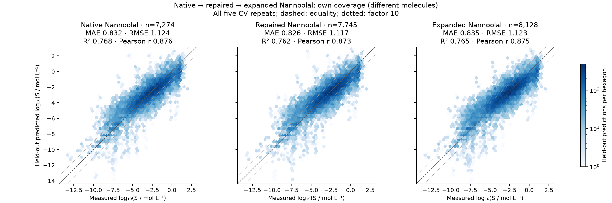
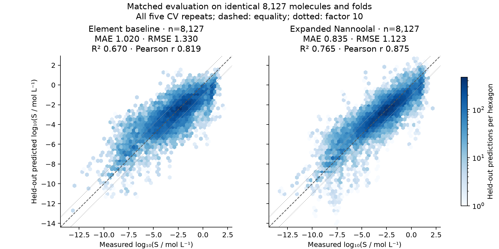
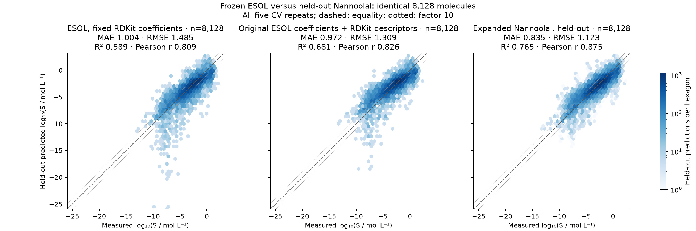

# Solubility headline metrics: Nannoolal regressions

Updated 2026-10-23. These models predict **absolute room-temperature aqueous
log10(S / (mol/L))** from structural group counts. They are empirical regressions,
not predictions from the published Nannoolal pure-property equations.

**Expanded Nannoolal: R² = 0.765, RMSE = 1.123, MAE = 0.835, Pearson r = 0.875,
and 69.2% within a factor of ten**, on 8,128 valid held-out molecules.
Its main benefit over native Nannoolal is coverage: full-data structural
coverage rises from **80.5% to 91.0%**, with effectively unchanged accuracy on
the previously supported molecules. It does not establish a general accuracy
win over every other encoding; NIST and native Nannoolal were effectively tied
on their earlier matched population.

## Native, repaired, and expanded Nannoolal

All adaptive models use training-selected nonlinear size terms and ridge
strength. The population is 9,044 neutral, connected, carbon-containing
structures. Each row uses that model's own valid population, so rows are
**not a controlled ranking**. Error metrics and signed bias are in log10 units.

| Model | Valid molecules | MAE ↓ | RMSE ↓ | Predictive R² ↑ | Pearson r ↑ | Within ×2 ↑ | Within ×10 ↑ | Signed bias |
|---|---:|---:|---:|---:|---:|---:|---:|---:|
| Native Nannoolal, adaptive | 7,274 | 0.832 | 1.124 | 0.768 | 0.876 | 26.0% | 69.6% | −0.0013 |
| Study-repaired Nannoolal, adaptive | 7,745 | 0.826 | 1.117 | 0.762 | 0.873 | 26.4% | 69.7% | −0.0008 |
| **Study-expanded Nannoolal, adaptive** | **8,128** | **0.835** | **1.123** | **0.765** | **0.875** | **26.0%** | **69.2%** | **−0.0029** |
| Study-expanded Nannoolal, OLS | 8,130 | 0.903 | 1.233 | 0.717 | 0.847 | 23.8% | 65.8% | −0.0026 |



Each panel shows measured versus held-out predicted log solubility. All five
CV repeats are shown separately, with the same axes and density scale.
The dashed line is equality; dotted lines mark tenfold error. No valid points
are cropped. The near-zero overall bias does not mean small individual errors:
roughly 31% of expanded-model predictions miss by more than a factor of ten.

## Matched comparisons: what actually improves?

Each pair below uses identical test molecules and folds. Training populations
can differ: expanded Nannoolal learns from the larger represented training
domain, so these comparisons measure its combined practical effect rather than
isolating the descriptor change alone.

| Test population | Model | MAE ↓ | RMSE ↓ | R² ↑ | Pearson r ↑ | Within ×10 ↑ |
|---|---|---:|---:|---:|---:|---:|
| Same 7,265 old-domain molecules | Native Nannoolal | 0.8311 | 1.1212 | 0.7687 | 0.8767 | 69.6% |
| Same 7,265 old-domain molecules | Expanded Nannoolal | 0.8314 | 1.1175 | 0.7702 | 0.8776 | 69.4% |
| Same 8,127 expanded-domain molecules | Element counts + size/ridge | 1.0203 | 1.3303 | 0.6702 | 0.8188 | 59.3% |
| Same 8,127 expanded-domain molecules | Expanded Nannoolal | **0.8350** | **1.1232** | **0.7649** | **0.8746** | **69.2%** |

- **Expanded versus native:** MAE difference +0.00027, simultaneous 95%
  interval [−0.00331, +0.00388]. There is no resolved MAE change. The small
  RMSE/R² improvements are descriptive; no new significance test was run for them.
- **Expanded versus element counts:** MAE reduction **18.2%**; difference
  −0.18530, interval [−0.20418, −0.16679]. RMSE is descriptively **15.6% lower**,
  and the fraction within tenfold error is **9.9 percentage points higher**.
  These MAE intervals are the saved molecule/repetition bootstrap results,
  adjusted for nine comparisons.



The [matched native-versus-expanded plot](results/nannoolal-headline-metrics/matched_native_adaptive.png)
shows the essentially unchanged old-domain predictions.

## Fixed ESOL benchmark on the same 8,128 molecules

Both ESOL equations produced valid predictions for **all 8,128 molecules** in
the expanded Nannoolal evaluation cohort: no descriptor failures or invalid
predictions were removed. ESOL uses fixed published coefficients, with **no
fit or bias correction on this study**. Nannoolal uses its saved held-out
predictions. These are identical test structures and solubility targets.

| Model | MAE ↓ | RMSE ↓ | Predictive R² ↑ | Pearson r ↑ | Signed bias | Within ×10 ↑ |
|---|---:|---:|---:|---:|---:|---:|
| Fixed RDKit ESOL (main reference) | 1.004 | 1.485 | 0.589 | 0.809 | −0.318 | 63.9% |
| Original ESOL coefficients + RDKit descriptors (sensitivity) | 0.972 | 1.309 | 0.681 | 0.826 | +0.090 | 62.6% |
| **Expanded Nannoolal, held-out** | **0.835** | **1.123** | **0.765** | **0.875** | **−0.003** | **69.2%** |

Expanded Nannoolal reduces MAE by **16.8%** versus fixed RDKit ESOL, and by
**14.1%** versus the original-coefficient sensitivity. The paired differences
(Nannoolal minus ESOL) are **−0.169**, simultaneous 95% interval
**[−0.192, −0.145]**, and **−0.137 [−0.153, −0.122]**, respectively.
Intervals resample molecules and Nannoolal repeat indices, with correction
for the four ESOL comparisons below; they condition on saved predictions.



The [original ESOL paper](https://doi.org/10.1021/ci034243x) used Daylight
descriptors. The main reference is Patrick Walters's
[RDKit coefficient refit](https://github.com/PatWalters/solubility/blob/9e0e55fd7040575e8427079c44759d51dc7c2216/esol.py).
The second row applies the original coefficients to RDKit descriptors; it is
**not an exact recreation of the original Daylight model**. It happens to do
better than the RDKit coefficient refit on this population, but the main and
sensitivity roles were specified before scoring. Neither version was fitted
to these labels. MW means average molecular weight, not exact mass; the pinned
upstream implementation supplies all four descriptors and both equations.

Calibration overlap matters: **1,038 molecules** match the public Delaney
calibration table by full standard InChI; **1,136** match when stereochemistry
is removed. Excluding the latter leaves **6,992 identical test molecules**:

| Model | MAE ↓ | RMSE ↓ | R² ↑ | Within ×10 ↑ |
|---|---:|---:|---:|---:|
| Fixed RDKit ESOL | 1.046 | 1.553 | 0.564 | 62.3% |
| Original coefficients + RDKit descriptors | 0.998 | 1.345 | 0.673 | 61.6% |
| **Expanded Nannoolal, held-out** | **0.853** | **1.148** | **0.762** | **68.4%** |

The corrected paired MAE intervals still favor Nannoolal: **[−0.220, −0.167]**
versus RDKit ESOL and **[−0.163, −0.128]** versus original coefficients.
The exclusion selects test molecules only; Nannoolal is not retrained.
The public table is not Delaney's complete original 2,874-compound training
set, so this is an overlap sensitivity, **not independent external validation**.
One public structure can match several study stereoisomers in this conservative
audit. ESOL has one fixed prediction per molecule; it is repeated solely to
align losses and plotting weights with Nannoolal's five CV repeats.

The [ESOL report](results/esol-comparison/REPORT.md),
[per-molecule predictions](results/esol-comparison/predictions.csv), and
[full-precision metrics](results/esol-comparison/headline_metrics.csv) retain
all calculations, descriptor values, calibration flags, and uncertainty.

## Coverage and invalid predictions

| Model | Full-data structural coverage | Supported in every CV repeat | Valid in every repeat | Invalid supported predictions, across five repeats |
|---|---:|---:|---:|---:|
| Native, adaptive | 7,278 / 9,044 (80.5%) | 7,278 | 7,274 | 17 / 36,390 (0.047%) |
| Repaired, adaptive | See held-out support¹ | 7,749 | 7,745 | 16 / 38,826 (0.041%) |
| Expanded, adaptive | **8,228 / 9,044 (91.0%)** | **8,133** | **8,128** | **21 / 40,894 (0.051%)** |

¹The saved full-data catalogue reports fully expanded coverage, not a separate
repaired-only total. The repaired row therefore uses the recorded held-out
support rather than inferring a full-data number.

Expanded groups recover **950 native failures**, preserve all 7,278 complete
native assignments, and leave 816 unsupported in the descriptive audit.
The 23 new study groups each require at least **20 distinct fully represented
training molecules**. Support and backoff are fitted independently in every
inner and outer training fold; test molecules cannot make a group eligible.

An invalid prediction is nonfinite or outside the declared numerical range
**[−30, 3] log10 mol/L**; predictions are never clipped. Unavailable structures
are separate from invalid numerical predictions. Conditional metrics require
validity in every repeat, excluding four native, four repaired, and five
expanded molecules from their respective always-supported populations.
Fold-specific support varies, so supported prediction counts are not simply
five times the always-supported population.

## Do the original structural corrections help?

On the earlier **same 7,272 valid molecules**, native first-order counts give
MAE **0.831**, RMSE **1.121**, R² **0.769**, and **69.6%** within tenfold error.
Adding the native second-order structural corrections gives **0.827**, **1.117**,
**0.770**, and **69.9%**, respectively. Their practical improvement is small,
and the MAE advantage does not survive the earlier full comparison correction.
Those native correction counts are distinct from the study-only assignment
repairs and new groups. See the [original comparison](results/nannoolal-aqueous-regression/REPORT.md).

## What the metrics mean and how they were validated

- **MAE:** mean absolute log error. For expanded Nannoolal, 0.835 corresponds
  to a geometric mean absolute error factor of **6.84**.
- **RMSE:** root mean squared log error; penalizes large misses more strongly.
- **Predictive R²:** `1 − MSE / variance(measured logS)`. Scores use held-out
  predictions, not a fitted line through the plot. It can be negative.
- **Pearson r:** correlation between measured and predicted logS. It measures
  association, not calibration, and **r² is not predictive R²**. A constant
  prediction shift can preserve r while worsening R² and both error metrics.
- **Signed bias:** mean predicted minus measured logS. Positive is
  overprediction. Cancellation can hide large individual errors.
- **Within ×2 / ×10:** fractions with absolute log error at most log10(2) / 1.

Validation uses **five molecular folds repeated five times**, with three-fold
inner validation for size terms and ridge strength. There is one target per
full molecular identity. Errors are scored for each held-out prediction before
averaging losses across repeats; predictions are **not averaged into an ensemble**.
Each molecule has equal weight. Correlation uses the same pooled held-out
predictions and repeated targets; repetitions are not additional independent
molecules. No correlation p-values are claimed.

Labels use AqSolDB on overlaps plus BigSolDB-only water measurements at
20–30 °C. Unknown pH, ionization, and solid form remain uncertainties; neutral
structure does not guarantee neutral experimental species. This is random
molecule CV, not unseen-scaffold or independent external validation.
The production Nannoolal implementation and property tables remain unchanged.

## Files and reproducibility

- [Headline metrics CSV](results/nannoolal-headline-metrics/headline_metrics.csv)
  and [JSON](results/nannoolal-headline-metrics/summary.json): own and matched
  metrics, correlation, support, and invalid counts at full precision.
- [Expanded-study report](results/expanded-nannoolal-regression/REPORT.md):
  regression details, group admission, and original paired uncertainty.
- [Metric/plot renderer](summarize_nannoolal_metrics.py): derives these statistics
  from saved predictions, checks them against saved scores, and writes PNG/SVG
  plots with portable fingerprints. **No models were refitted.**
- [Fixed ESOL benchmark](scripts/benchmark_esol.py): evaluates the pinned
  upstream equations without retraining and audits public calibration overlap.
- [Earlier MAE detail](MAE_SUMMARY.md) and
  [complete MAE inventory](results/mae-inventory-20261023/all_saved_MAEs.csv):
  supporting comparisons, including the distinct solvent-transfer task.

For a fresh rendering, supply a new output directory:

```sh
python solubility/summarize_nannoolal_metrics.py --output-dir solubility/results/new-nannoolal-metrics
```
